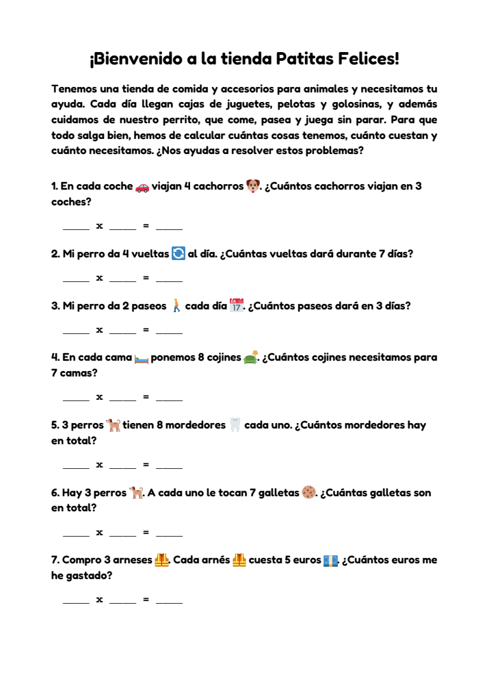
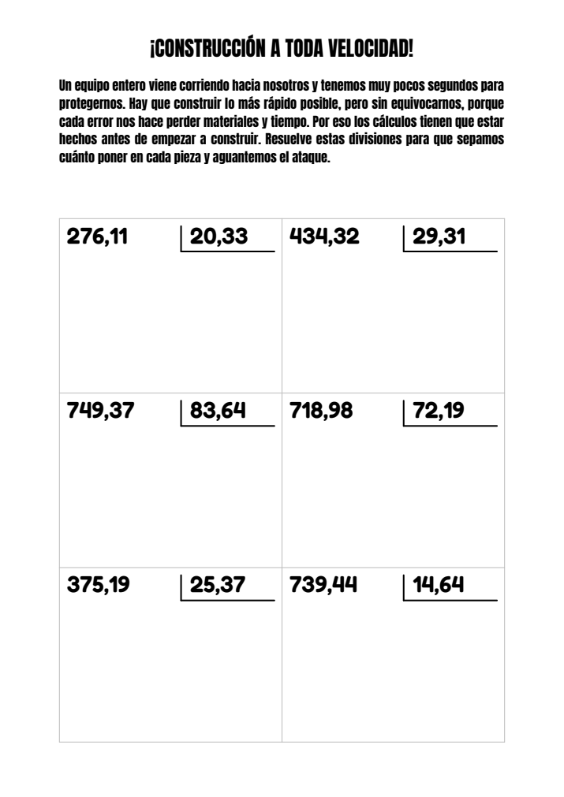

# Operaciones

Genera fichas de ejercicios de matemáticas en PDF para practicar. Cada
ficha es distinta, se puede enviar por correo y también generar desde el
navegador: la página web tiene un botón por ejercicio.

Ejercicios disponibles:

| Multiplicaciones | Divisiones |
|---|---|
|  |  |

**Multiplicaciones** (tienda «Patitas Felices»): 10 problemas con texto y
emojis sobre una tienda de animales, con una línea `____ x ____ = ____`
para responder. Al final va una tabla de multiplicar ya resuelta, como
referencia.
- Solo salen las tablas del 2 al 9. El 0, el 1 y el 10 no aparecen nunca.
- Se pueden elegir las tablas de los problemas. Si no se elige ninguna,
  salen todas.
- La tabla de referencia se elige al azar y no se repite hasta que han
  salido las 8.

**Divisiones** (temática de Fortnite): 6 divisiones con decimales en una
cuadrícula de 2 x 3, pensadas para resolverlas sobre el PDF con el lápiz de
una tablet.
- El dividendo va de 100,01 a 999,99 y el divisor de 10,01 a 99,99. La
  última cifra decimal nunca es 0.
- La cabecera se elige al azar entre 100 historias de Fortnite y no se
  repite hasta que han salido todas.

## Instalación

Hace falta [uv](https://docs.astral.sh/uv/). uv instala solo Python 3.13 si
no lo tienes.

```bash
git clone <URL-del-repositorio> operaciones
cd operaciones
uv sync
```

`uv sync` crea el entorno `.venv/`, instala reportlab (la versión exacta de
`uv.lock`) e instala el propio programa como el comando `operaciones`.

Para enviar las fichas por correo, crea el fichero `.env` con los datos
SMTP:

```bash
cp .env.ejemplo .env      # y rellénalo, o copia el .env de otro ordenador
```

El `.env` contiene la contraseña, así que **no se sube a git**: hay que
copiarlo a mano a cada ordenador.

Un solo `.env` sirve para todos los ejercicios. La cuenta SMTP y el
remitente son comunes. Solo los destinatarios pueden ser distintos en cada
ejercicio, si se pone su nombre delante: `DIVISIONES_DESTINATARIOS=...` solo
se usa para divisiones. Los ejercicios que no tienen los suyos usan
`DESTINATARIOS`.

Los datos del correo se leen **solo** de este fichero (o, en Docker, del
secreto). Las variables de entorno no se usan, así que una variable con el
mismo nombre que se haya quedado en la terminal no cambia nada. Si al usar
`-e` no se encuentra el fichero o le falta algún dato, el programa avisa y
termina antes de generar la ficha. Sin `-e` no hace falta tener `.env`.

## Uso

```bash
uv run operaciones multiplicaciones              # todas las tablas
uv run operaciones multiplicaciones 3 6 9        # solo las tablas 3, 6 y 9
uv run operaciones divisiones -o x.pdf           # elegir el nombre del PDF
uv run operaciones divisiones -e a@x.com         # además, enviarla por correo (-e se puede repetir)
uv run operaciones multiplicaciones 3 6 -e       # -e sin dirección: a los destinatarios del .env
uv run operaciones -h                            # ayuda (y operaciones <ejercicio> -h)
```

Con multiplicaciones, el `-e` sin dirección va **después** de las tablas.
Si va antes, se tomaría la primera tabla como si fuera la dirección.

Sin `-o`, el PDF se guarda en la carpeta actual con un nombre como
`divisiones_08-11_15h30_2026_012.pdf`. En esa misma carpeta se guarda la
rotación de cada ejercicio (`tablas_salidas.json`, `cabeceras_salidas.json`).
Por consola se indica qué tabla o qué cabecera ha salido.

### Página web

```bash
uv run operaciones servidor -p 8000   # http://localhost:8000
```

La página muestra un botón por ejercicio («Multiplicaciones»,
«Divisiones»). Al pulsar uno, se crea la ficha y se envía por correo a los
destinatarios de ese ejercicio en el `.env`. Después de cada ficha hay que
esperar 20 segundos antes de generar otra, de cualquier ejercicio, para no
mandar correos repetidos por error. Lo que escribe el programa (PDF
generado, tabla o cabecera elegida, errores) sale solo en la consola del
servidor, no en la página.

Los PDF se guardan en `pdfs/<ejercicio>/` dentro de la carpeta desde la que
se arranca el servidor (se puede cambiar con la variable de entorno
`CARPETA_PDFS`).

Sin `-p` el servidor escucha en el puerto 80, que es el que usa en Docker.
Fuera de Docker un usuario normal no puede usar el 80; por eso se usa `-p 8000`.

### Docker

```bash
docker compose up -d --build        # servidor web en el puerto 80 del contenedor
docker logs operaciones             # ver qué fichas se han generado
```

El contenedor no publica ningún puerto en el host: está pensado para ir
detrás de Nginx Proxy Manager, en la misma red de Docker. En NPM se apunta
a `operaciones` (el nombre del contenedor), puerto `80`. Para unirlo a la
red de NPM, descomenta el bloque `networks` de `docker-compose.yml` y pon el
nombre de esa red.

El `.env` se pasa al contenedor como **secreto de Docker**
(`operaciones_env`), así que la contraseña no queda dentro de la imagen ni
aparece en `docker inspect`. El fichero tiene que poder leerlo el usuario
1000, que es con el que corre el contenedor. En Portainer, en `file:` del
secreto va la ruta absoluta del fichero en el servidor, que puede tener
cualquier nombre.

Los PDF y la rotación de cada ejercicio se guardan en `/app/pdfs/<ejercicio>`,
dentro del volumen de Docker **`operaciones_pdfs`**. Así se conservan al
recrear o actualizar el contenedor: la rotación sigue donde iba y la
numeración de los PDF no vuelve a empezar. `docker compose down` no borra
el volumen; para borrarlo, `docker compose down -v` o desde Portainer. Los
PDF se van acumulando (unos 30-40 KB cada uno) y nada los borra.

## Personalizar

Cada ejercicio está en su carpeta, `src/operaciones/ejercicios/<ejercicio>/`:

- **Aspecto de la ficha** (fuentes, tamaños, márgenes, colores...):
  constantes al principio de su `pdf.py`.
- **Textos de los problemas o de las cabeceras**: `situaciones.py`
  (multiplicaciones) y `cabeceras.py` (divisiones). Para dar más variedad,
  basta con añadir entradas.
- **Rango de los números y número de ejercicios**: constantes al principio
  de su `generar.py`.
- **Texto del botón y del correo**: `NOMBRE`, `NOMBRE_REMITENTE` (el nombre
  con el que llega el correo: «Patitas Felices», «Batalla Fortnite»),
  `ASUNTO_EMAIL` y `TEXTO_EMAIL` en su `__init__.py`. La dirección del
  remitente es la misma para todos y está en el `.env`.

### Añadir un ejercicio nuevo

1. Crea su carpeta en `src/operaciones/ejercicios/`, usando la de
   divisiones como modelo.
2. En su `__init__.py` define lo que pide `ejercicios/__init__.py`:
   `NOMBRE`, `DESCRIPCION`, `NOMBRE_REMITENTE`, `ASUNTO_EMAIL`, `TEXTO_EMAIL`,
   `anadir_argumentos`, `comprobar` y `crear_pdf`.
3. Añádelo al diccionario `EJERCICIOS` de `ejercicios/__init__.py`.

La línea de comandos, el servidor, la página web (el botón) y el correo lo
recogen solos. Si debe ir a otras personas, añade sus
`<EJERCICIO>_DESTINATARIOS` al `.env`.

La explicación de cada fichero y de cada función está en
**[AYUDA.md](AYUDA.md)**.

## Licencias de terceros

- Fuente **Anton** © The Anton Project Authors, con licencia
  [SIL Open Font License 1.1](src/operaciones/fonts/OFL-Anton.txt).
- Fuente **Fredoka** © The Fredoka Project Authors, con licencia
  [SIL Open Font License 1.1](src/operaciones/fonts/OFL-Fredoka.txt).
- Emojis de **[Twemoji](https://github.com/jdecked/twemoji)** © Twitter, Inc.
  y otros colaboradores, con licencia
  [CC-BY 4.0](https://creativecommons.org/licenses/by/4.0/).

Fortnite es una marca registrada de Epic Games, Inc. Este proyecto es un
material educativo no oficial, sin relación con Epic Games.
